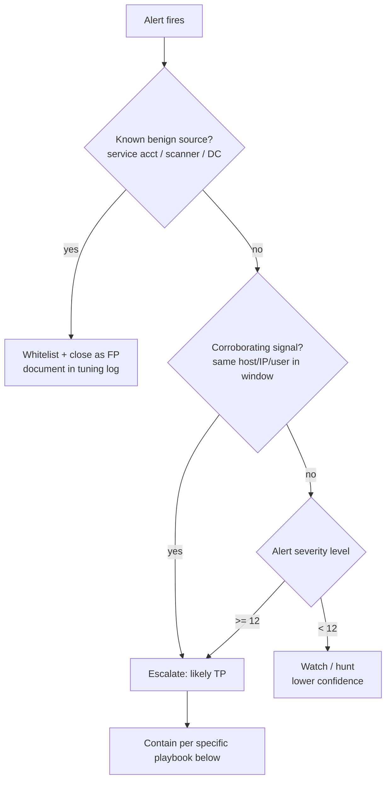

# Triage playbook — AD & web attack alerts

A reusable decision tree for the alert types in this lab. The goal: a consistent,
defensible triage a SOC analyst can follow under pressure, with clear escalation
criteria so nothing high-severity gets sat on and nothing benign wakes someone at 3am.

---

## General triage flow (any alert)

---

## Rule 100012 — DCSync (level 12, critical)

**What to check**
1. Is `subjectUserName` a **Domain Controller machine account** (ends in `$`) or
   `SYSTEM` (S-1-5-18)? → **legitimate replication, close as FP.**
2. Is it a **user or non-DC account**? → **true positive, treat as domain compromise.**
3. Which replication GUID? `1131f6aa` / `1131f6ad` = Get-Changes(-All).

**Escalation criteria:** any non-DC principal → **immediate P1**. `krbtgt` exposure =
assume full domain compromise.

**Containment:** disable the account, isolate the source host, **rotate krbtgt twice**.

## Rule 100011 — AS-REP Roasting (level 10)

**What to check**
1. `preAuthType 0` on the 4768 → the account has pre-auth disabled (abnormal).
2. Is the account *supposed* to have pre-auth off (rare legacy interop)? Check the
   allow-list. If not → TP.
3. External / unexpected `ipAddress`? Raises confidence.

**Escalation:** TP → investigate for follow-on cracking + reuse (pivot to DCSync/lateral
movement from the same source).

**Containment:** re-enable pre-auth on the account; force a password reset (assume the
hash is being cracked offline).

## Rule 100010 — Kerberoasting (level 10)

**What to check**
1. `ticketEncryptionType 0x17` (RC4) for an SPN `serviceName`.
2. One user requesting many SPN tickets in a short window → stronger signal.
3. Legacy app that genuinely needs RC4? Allow-list by `serviceName`.

**Escalation:** burst of RC4 TGS for service accounts → TP; the targeted service
account's password is being cracked.

**Containment:** rotate the service account password (prefer gMSA); force AES.

## Rules 100014 / 100015 — Web SQLi / XSS (level 12 / 10)

**What to check**
1. Inspect `data.log` — the full request URI. Is the payload a real injection
   (`UNION SELECT`, `<script>`) or a substring false positive?
2. **Response code**: 200 on an injection request suggests success; 3xx/4xx suggests
   blocked/redirected.
3. Same source IP across multiple attack requests → single actor, escalate.

**Escalation:** successful SQLi (200 + data-sized response) → **P1**, assume DB /
credential exposure.

**Containment:** block source IP, WAF-block the pattern, take the endpoint offline;
reset any exposed credentials.

---

## Escalation summary

| Signal | Confidence | Action |
|--------|-----------|--------|
| DCSync by non-DC | Near-certain | P1 now — domain compromise |
| Successful web SQLi (200 + large response) | High | P1 — DB/cred exposure |
| AS-REP / Kerberoast (RC4) TP | High | P2 — offline cracking in progress |
| Enumeration burst alone | Low | Hunt / watch; escalate if corroborated |
| Signal from allow-listed benign source | — | Close as FP, log it |
